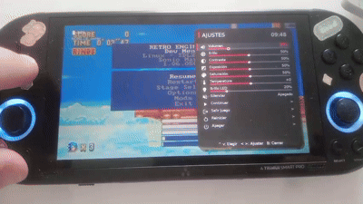

<p align="center">
  
</p>

<h1 align="center">OverLyder</h1>

<p align="center">
  Quick settings for the TrimUI Smart Pro on CrossMix.
</p>

<p align="center">
  
  
</p>

<p align="center">
  
</p>

Hold the Home button (or a combo you choose) and a Switch-style overlay slides over whatever you're playing. The game doesn't need to support anything. OverLyder freezes it and draws the panel over the screen. Close it and you land right back where you were.

## Features

- Volume, brightness, contrast, exposure, saturation, colour temperature, LED brightness and LED color (static RGB, restored at boot)
- Mute, quit the game, reboot and shut down
- Virtual keyboard: opens from the overlay, sends real key presses to the app underneath and returns to the panel with B/Home
- No patches or setup inside the game
- Trigger, hold time, language (Spanish, English, Portuguese, from JSON files) and the SIGSTOP/layer mode set from the app
- Built-in updater in the app: shows the installed version and checks GitHub releases for a newer one

## Install

Grab the zip from the Releases page, unzip it and copy what's inside into `Apps/` on your SD card. Then open **OverLyder** in CrossMix and enable the overlay.

If you're on the device over SSH, run `sh install.sh` as root from the repo root. `uninstall.sh` takes it off again. Both scripts back up your config first.

## Use

| | |
| --- | --- |
| Open the panel | hold <kbd>Home</kbd> for about 700 ms |
| Move around | D-pad or stick |
| Change a value | left/right |
| Close it | <kbd>B</kbd> or <kbd>Home</kbd> |

### Virtual keyboard

Pick **Keyboard** in the panel and press <kbd>A</kbd>. The panel hides and a full-screen keyboard takes over:

| | |
| --- | --- |
| Move between keys | D-pad or stick |
| Type / activate a key | <kbd>A</kbd> |
| Back to the overlay | <kbd>B</kbd> or <kbd>Home</kbd> |
| Shift / symbols | <kbd>Y</kbd> / <kbd>X</kbd> |
| Backspace / confirm | <kbd>Select</kbd> / <kbd>Start</kbd> |

Keys are injected through a virtual keyboard device created at daemon startup, so games can enumerate it like a physical keyboard. Going back always returns to the same overlay screen with the Keyboard row focused.

The panel and keyboard are drawn on their own alpha-blended hardware display
layer, so the game keeps running and nothing fights over `/dev/fb0` (no
SIGSTOP flicker). If no free layer is available, OverLyder falls back to the
old freeze-the-game behaviour. The last typed text is also saved to
`/tmp/overlyder.keyboard.txt`.

### SIGSTOP or no SIGSTOP

Both modes ship in the same binaries. You can switch with the new **Capa sin
SIGSTOP** / **Layer, no SIGSTOP** row in the app's settings screen (values
Sí/No), or by editing `no_sigstop` in
`/mnt/SDCARD/System/etc/overlay.cfg`:

- `no_sigstop=1` (default) — draw on a hardware display layer; the game is
  never stopped. Automatically falls back if no layer can be claimed.
- `no_sigstop=0` — classic behaviour: freeze the game and MainUI with SIGSTOP
  while the panel is up.

`OVERLAY_NO_LAYER=1` forces the fallback for a single run, and
`OVERLAY_DEBUG=1` logs input and layer decisions to `/tmp/overlayd.log`.

The reverse-engineering, device measurements and pitfalls behind the layer
approach are documented in [docs/NO_SIGSTOP_OVERLAY.md](docs/NO_SIGSTOP_OVERLAY.md).

You can tweak the trigger and timing from the app.

## Languages

All UI strings are flat JSON files in `app/lang/` (`es.json`, `en.json`,
`pt.json`), installed to `Apps/OverLyder/lang/`. See
[docs/LANGUAGES.md](docs/LANGUAGES.md) for the format, loading order, fallback
and how to add a language.

## Build from source (Windows host)

`scripts/build-win.ps1` cross-compiles with Zig 0.14.1 for
`aarch64-linux-gnu.2.33` and produces `dist/OverLyder` plus `dist/bin`:

```powershell
.\scripts\build-win.ps1
```

It looks for SDL2 / SDL_ttf headers under `%TEMP%\sdl` (auto-detects
`SDL2-* / include` and `SDL2_ttf-* / include`) and for the aarch64 shared
libraries in `%TEMP%\libs` as `libSDL2.so` / `libSDL2_ttf.so`. Get those two
`.so` files from `/usr/trimui/lib/` on the device (`libSDL2-2.0.so.0` and
`libSDL2_ttf-2.0.so.0`) and rename/copy them there. Every path can be
overridden with `-Zig`, `-SdlInc`, `-TtfInc`, `-SdlLib`, `-Target` and `-Out`.

On Linux/macOS, `scripts/build-docker.sh` does the same with Docker but needs
a `third_party/` bundle (`third_party/SDL/include`, `third_party/SDL_ttf`,
`third_party/libs`).

## Updates

The app presents an updater, which pulls directly from the releases in this github page.

## License

MIT. See [LICENSE](LICENSE). The bundled Material Icons font is Apache 2.0, and its license lives in `app/resources/LICENSE-MaterialIcons.txt`.
